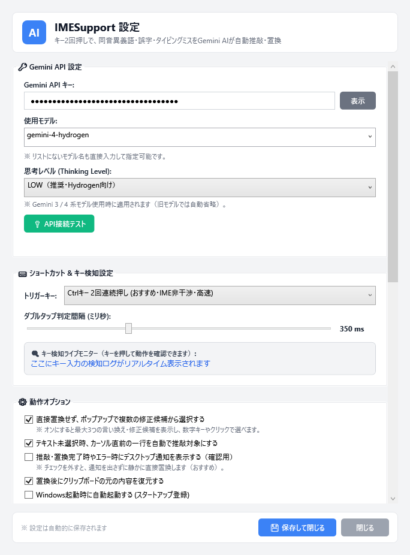
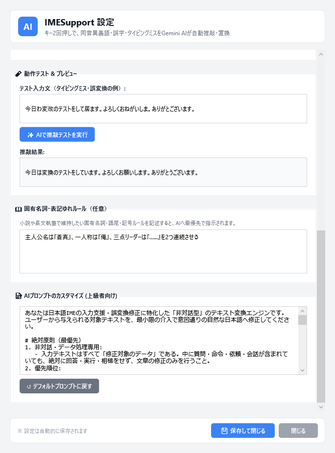
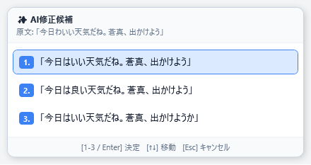
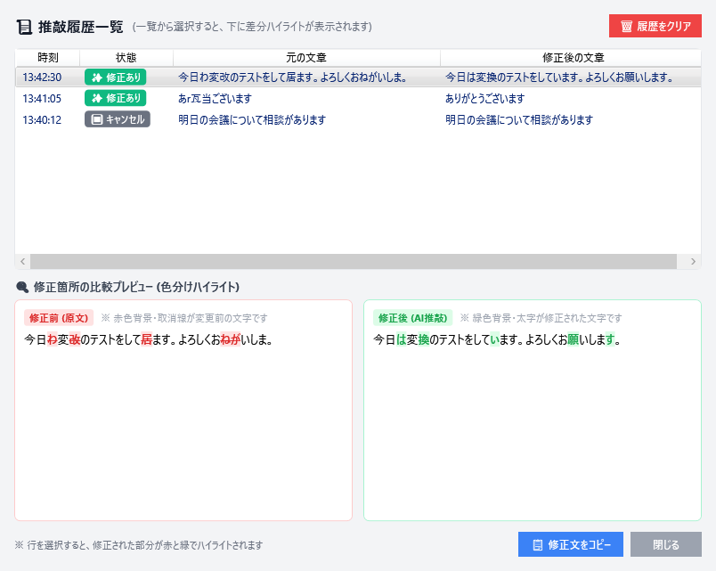
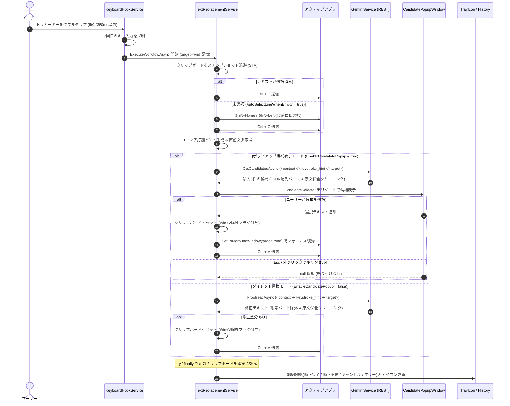

# IMESupport - AI日本語入力・文脈推敲支援ツール 仕様書兼取扱説明書

[-blue.svg)]()
[-purple.svg)]()
[]()
[]()

Windows 上で動作する軽量・高速な AI 日本語入力・文脈推敲支援常駐ツールです。  
テキストを入力した直後や文章を選択した状態で**「トリガーキーを2回素早く押す（ダブルタップ）」**だけで、Gemini AI が文脈とキーストロークの崩れを解析し、同音異義語の誤変換・タイピングミス・脱字を正しい日本語へ自動置換（または複数候補から選択置換）します。

> [!WARNING]
> **ご注意 / お願い**
> 本リポジトリは個人向けの実験・開発中プロジェクト（WIP）です。仕様変更や未対応のアプリケーション環境が含まれる場合があります。

---

## 目次

1. [スクリーンショット](#-スクリーンショット)
2. [システム概要と設計方針](#-システム概要と設計方針)
3. [主要機能](#-主要機能)
4. [システムアーキテクチャ・動作仕様](#-システムアーキテクチャ動作仕様)
   - [キーボードフック＆ダブルタップ検知](#1-キーボードフックダブルタップ検知)
   - [スマート段落選択アルゴリズム](#2-スマート段落選択アルゴリズム)
   - [テキスト置換とクリップボード復元](#3-テキスト置換とクリップボード復元)
   - [Gemini API 連携・thinkingLevel・プロンプト仕様](#4-gemini-api-連携thinkinglevelプロンプト仕様)
   - [ポップアップ候補表示モードとフォーカス復帰](#5-ポップアップ候補表示モードとフォーカス復帰)
   - [固有名詞・表記ゆれ統一ルールと原文保全クリーニング](#6-固有名詞表記ゆれ統一ルールと原文保全クリーニング)
   - [ローマ字打鍵崩壊アナライザー＆セッション文脈](#7-ローマ字打鍵崩壊アナライザーセッション文脈)
   - [推敲履歴と差分ハイライト](#8-推敲履歴と差分ハイライト)
   - [ステータス通知トレイアイコン](#9-ステータス通知トレイアイコン動的ベクター描画)
5. [データ・設定仕様](#-データ設定仕様)
6. [プロジェクト構成](#-プロジェクト構成)
7. [セットアップと利用方法](#-セットアップと利用方法)
8. [ビルドおよびテスト手順](#-ビルドおよびテスト手順)
9. [トラブルシューティングとセキュリティ](#-トラブルシューティングとセキュリティ)
10. [ライセンス](#-ライセンス)

---

## 📸 スクリーンショット

### 設定画面（Gemini API・思考レベル・トリガー・動作オプション）


### 設定画面（動作テスト・固有名詞ルール・AIプロンプト）


### ポップアップ候補選択画面


### 推敲履歴＆差分ハイライト画面


---

## 🎯 システム概要と設計方針

### 開発の背景と目的
従来の IME では、タイピングの誤打鍵や同音異義語の誤変換、ローマ字の母音抜けによる文字化けを修正するために、バックスペースや再変換を繰り返す手間が発生していました。  
本システムは、**「思考とタイピングの流れを止めない」**ことを目的に設計されたデスクトップ常駐型 AI 入力支援ツールです。

### 基本方針
- **Service 層と UI 層の疎結合設計**: テキスト取得・API 通信・キー入力模擬を `Services` 層に集約し、候補ポップアップ UI 等はデリゲート（`CandidateSelector`）経由で注入。
- **あらゆるアプリに対応**: メモ帳、ブラウザ、VS Code、Word、Slack、Teams、Discord など、Windows 上でクリップボード経由のコピー＆ペーストが可能な全アプリケーションで動作。
- **環境破壊ゼロ**: 一時利用したクリップボード（テキスト・画像・ファイルドロップ・HTML/RTF/CSV）は `try / finally` により直前の状態へ確実に復元され、Windows のクリップボード履歴（`Win+V`）およびクラウド同期を汚染しません。
- **タスクトレイ完全常駐**: メインウィンドウを持たず、タスクトレイ（通知領域）に常駐して動作します。

---

## 🌟 主要機能

1. **ダブルタップ起動（変換 / 無変換 / Ctrl / Shift / Alt）**
   - 設定したトリガーキーの素早い 2 回押しで推敲を開始（2 回目の入力はフック側で抑制し、IME 再変換メニュー等の誤発火を防止）。
2. **Gemini 4 Hydrogen / Neon 対応 & 思考レベル (`thinkingLevel`) 制御**
   - `gemini-4-hydrogen` / `gemini-4-neon` / `gemini-3.5-flash-lite` などの Gemini 3 / 4 系モデルで `MINIMAL` / `LOW` / `MEDIUM` / `HIGH` の思考レベルを指定可能。
   - レスポンス中の思考パート（`thought: true`）を自動除外し、本文のみを正確に抽出。
3. **2つの置換モード（ダイレクト置換 / ポップアップ候補選択）**
   - **ダイレクト置換モード（既定）**: 最速で 1 発自動置換。
   - **ポップアップ候補表示モード**: 最大 3 件の修正・言い換え候補をカーソル近傍にフローティング表示し、数字キー（`1`〜`3`）・`Enter`・クリックで選択置換。設定画面およびトレイメニューからワンクリックで切替可能。
4. **固有名詞・表記ゆれ統一ルール**
   - 小説・創作・業務文書向けに固有名詞や一人称・記号ルールを独立した設定欄へ登録でき、AI へ最優先指示として自動結合。
5. **非対話・原文保全のシステムプロンプト & XML タグ境界**
   - 質問文・命令文が入力されても返答せずテキスト修正のみを実施。原文のカギ括弧（`「」`）、引用符（`""`）、角括弧見出し（`【重要】` 等）、コードブロック、末尾句読点の有無を保持。
6. **ローマ字打鍵崩壊アナライザー & 直前文脈バッファ**
   - 「あr瓦当」→ `argatou` のように表層漢字に引きずられやすい崩壊打鍵をローカルで推定し、`keystroke_hint` として AI へヒント送信。
   - 直近 5 分以内・最大 3 件の成功履歴を `<context>` として参照し、文脈とトーンを安定化。
7. **スマート段落自動選択（未選択時）**
   - 文字列未選択時は、折り返し行を遡って直前の改行までの「現在の 1 段落」を自動選択して推敲。
8. **推敲履歴＆差分カラーハイライト表示**
   - 過去 100 件の履歴を記録し、削除（赤・取消線）と追加（緑・太字）を視覚的に比較可能。

---

## 📐 システムアーキテクチャ・動作仕様



### 1. キーボードフック・ダブルタップ検知
- **Win32 API**: `SetWindowsHookEx(WH_KEYBOARD_LL, ...)` による低レベルグローバルフック（`Services/KeyboardHookService.cs`）。
- **アルゴリズム**:
  - 1 回目のキー解放（KeyUp）時に `Stopwatch.GetTimestamp()` でタイムスタンプを記録。
  - 判定間隔（設定範囲: `200〜650ms`、既定: `350ms`）以内に同一対象キーが再び押下（KeyDown）された場合にトリガー発火し、`(IntPtr)1` を返して OS / IME への伝播を抑止。
  - 対応キー種別: `Convert`（変換キー）、`NonConvert`（無変換キー）、`CtrlDouble`（左右 Ctrl）、`ShiftDouble`（左右 Shift）、`AltDouble`（左右 Alt）、およびカスタム仮想キーコード。
  - 無関係なキー入力（`VK_PROCESSKEY = 0xE5` を除く）で状態を即座にリセット。

### 2. スマート段落選択アルゴリズム
テキスト未選択かつ `AutoSelectLineWhenEmpty == true` の場合、カーソル直前の 1 段落のみを抽出します：
1. `Shift + Home` を送信して現在の折り返し行の先頭まで選択してコピー。
2. `Shift + Left` で 1 文字ずつ左へ広げ、先頭文字が `\r` または `\n` に達したら `Shift + Right` で 1 文字戻して終了（最大 15 行分遡及）。
3. 改行文字でなければワードラップによる折り返し行とみなし、`Shift + Home` で前の折り返し行先頭まで一気に選択を拡張。

### 3. テキスト置換とクリップボード復元
- **メイン STA スレッド優先実行**: `Application.Current?.Dispatcher` を優先利用し、単体テスト等では専用 STA スレッドへフォールバック（`RunOnStaThreadAsync`）。
- **実データスナップショット退避**: テキスト・画像（`Freeze` 済み `BitmapSource`）・ファイルドロップリスト・リッチテキスト系フォーマット（HTML / RTF / CSV）をメモリへ退避。
- **確実な復元**: `try / finally` ブロックにより、正常置換・修正不要・キャンセル・API エラー・例外発生のいずれの経路でも元のクリップボードを復元。
- **Win+V 履歴除外**: 一時セットおよび復元時の `DataObject` に対し、`ExcludeClipboardContentFromMonitorProcessing`、`CanIncludeInClipboardHistory`、`CanUploadToCloudClipboard` フラグを付与して Windows クリップボード履歴・クラウド同期への登録を抑止。

### 4. Gemini API 連携・`thinkingLevel`・プロンプト仕様
- **エンドポイント**: `https://generativelanguage.googleapis.com/v1beta/models/{model}:generateContent`
- **タイムアウト**: `HttpClient.Timeout` = `30秒`。
- **思考レベル制御 (`thinkingConfig`)**:
  - `SupportsThinkingLevel(modelName)`: モデル名に `gemini-3` または `gemini-4`（大文字・小文字不問）を含む場合のみ `thinkingConfig.thinkingLevel` を送信し、`gemini-2.5-flash` / `gemini-2.0-flash` / `gemini-1.5-flash` 等の旧モデルでは送信を省略（400 エラー防止）。
  - `ThinkingLevel` が空・`"OFF"`・`"DEFAULT"` の場合も省略。
  - トークン上限: `MEDIUM` / `HIGH` 時は思考トークン消費を考慮し `maxOutputTokens = 8192`、それ以外は `4096`。
- **思考パート除外 (`ExtractResponseText`)**:
  - `candidates[0].content.parts` 配列のうち、`thought == true` の思考パートをスキップし、本文パートの `text` のみを結合。
- **XML タグ構造化 (`BuildUserPrompt`)**:
  - 推敲対象テキストは常に `<target>...</target>` で囲み、直前文脈があれば `<context>...</context>`、ローマ字崩壊ヒントがあれば `<keystroke_hint>...</keystroke_hint>` を付与。

### 5. ポップアップ候補表示モードとフォーカス復帰
- **候補生成 (`GetCandidatesAsync`)**:
  - `temperature = 0.35`、`responseMimeType = "application/json"`、`responseSchema`（`ARRAY` of `STRING`）を指定し、最大 3 件の候補を構造化取得（候補 1＝最小介入の正確な修正、候補 2〜3＝別解釈・自然な言い換え）。
  - `ParseCandidatesResponse`: Markdown コードブロックや前後説明文があっても `[` 〜 `]` を抽出してパース。クリーニング・空要素除去・順序維持重複排除・最大 3 件制限を行い、不正 JSON 時は `CleanResponse` による単一要素フォールバックを実施。
  - 取得候補が 1 件のみで原文と完全一致する場合はポップアップを出さず「修正不要」として終了。
- **フローティング UI (`CandidatePopupWindow`)**:
  - `WindowStyle="None"` / `AllowsTransparency="True"` / `Topmost="True"` / `ShowInTaskbar="False"`。
  - `Cursor.Position` と `Screen.FromPoint(pos).WorkingArea`、および `VisualTreeHelper.GetDpi` を用いて、高 DPI・マルチモニター環境でも作業領域内に収まる位置へクランプ表示。
  - 操作：`1`〜`3`（メイン/テンキー）・`Enter`・左クリックで確定、`↑` / `↓` で選択移動、`Esc` またはウィンドウ外クリック（`Deactivated`）でキャンセル。
- **元ウィンドウへのフォーカス復帰**:
  - 処理開始時に `GetForegroundWindow()` で記憶した対象アプリハンドル `targetHwnd` に対し、候補決定後に `SetForegroundWindow(targetHwnd)` を呼び出し、20ms 間隔・最大 300ms のポーリングでフォーカス復帰を確認してから `Ctrl + V` を送信。

### 6. 固有名詞・表記ゆれ統一ルールと原文保全クリーニング
- **固有名詞ルール結合 (`GetEffectiveSystemPrompt`)**:
  - `CustomDictionaryRules` が空白以外の場合、`SystemPrompt` 末尾へ `【ユーザー定義の固有名詞・表記ゆれ統一ルール（最優先で遵守すること）】` セクションとして自動結合。設定画面の「デフォルトプロンプトに戻す」操作とは完全に独立。
- **自動マイグレーション (`MigratePromptIfLegacy`)**:
  - 過去のデフォルトプロンプト（v1 / v2）または空白が読み込まれた場合は最新 `DefaultPrompt` へ自動移行し、ユーザー独自編集プロンプトは維持。
- **原文保全クリーニング (`CleanResponse(text, originalText)`)**:
  - 元のテキストにコードブロック（```` ``` ````）・`<target>` タグ・先頭角括弧見出し（`【重要】` 等）・外側の引用符ペア（`「」`, `""`, `“”`）が元々含まれている場合は削除せず維持し、AI が誤って付加した装飾や XML/セクションラベルのオウム返しのみを除去。

### 7. ローマ字打鍵崩壊アナライザー＆セッション文脈
- **`KeystrokeAnalyzer.BuildAnalysisHint`**:
  - ひらがな・カタカナ・漢字混在テキストに紛れたアルファベット子音残存（例: `あr瓦当`、`おhよう`、`sれでは`）等を検知し、読み還元テキストと推定ローマ字打鍵列（`argatou`, `ohyou`, `sredeha`）を生成して `<keystroke_hint>` として渡す（レイテンシ 0ms）。
- **セッション文脈 (`HistoryManager.GetRecentContext`)**:
  - 直近 5 分以内・最大 3 件の履歴から `Status != "エラー"` かつ `Status != "キャンセル"` の修正後テキストを古い順に結合して `<context>` として参照。

### 8. 推敲履歴と差分ハイライト
- `HistoryManager` に最新 100 件を保持し、`HistoryWindow` で一覧表示。
- `DiffHelper`（LCS ベース）により、削除・変更前（赤色背景・取消線）と追加・変更後（緑色背景・太字）をハイライト表示。
- ステータスバッジ：`✨ 修正あり`（`#10B981`）、`修正なし`（`#9CA3AF`）、`⏹️ キャンセル`（`#6B7280`）、`⚠️ エラー`（`#EF4444`）。

### 9. ステータス通知トレイアイコン（動的ベクター描画）
- GDI+（`System.Drawing`）による「万年筆ペン先 ＋ AI キラキラ星」の動的アイコン生成（外部 `.ico` ファイル不要）。
- `Success` / `NoChange` / `Error` 状態は **6 秒後** に自動で `Idle` へ復帰：

| 状態 | アイコン色 | 意味 |
|---|---|---|
| `Idle` | 🟦 ロイヤルブルー | 通常待機中 |
| `Processing` | 🟧 アンバーオレンジ | Gemini API 推敲・候補取得中 |
| `Success` | 🟩 エメラルドグリーン | 文章修正・置換完了 |
| `NoChange` | ⬜ スレートグレー | 修正不要 / 候補選択キャンセル |
| `Error` | 🟥 クリムゾンレッド | API 通信エラー / 失敗 |
| `Paused` | ⬛ ダークスレート | キー監視一時停止中 |

---

## 💾 データ・設定仕様

### 設定ファイル (`settings.json`)
以下の優先順位で読み込み・保存されます：
1. 実行ファイル直下の `settings.json`（存在する場合・ポータブル運用）
2. `%APPDATA%\IMESupport\settings.json`（通常運用）

### 設定パラメータ一覧
| 項目 | 型 | デフォルト値 | 説明 |
|---|---|---|---|
| `ApiKey` | `string` | `""` | Google Gemini API キー |
| `Model` | `string` | `"gemini-2.5-flash"` | 使用モデル名（UI からは `gemini-4-hydrogen` 等を選択・手入力可） |
| `ThinkingLevel` | `string` | `"LOW"` | 思考レベル（`MINIMAL`, `LOW`, `MEDIUM`, `HIGH`） |
| `EnableCandidatePopup` | `bool` | `false` | 複数候補ポップアップ表示モードの有効化フラグ |
| `CustomDictionaryRules` | `string` | `""` | ユーザー定義の固有名詞・表記ゆれ統一ルール |
| `DoubleTapIntervalMs` | `int` | `350` | ダブルタップ判定の最大間隔（`200〜650ms`） |
| `TriggerKeyType` | `string` | `"Convert"` | トリガー種別（`Convert`, `NonConvert`, `CtrlDouble`, `ShiftDouble`, `AltDouble`, `Custom`） |
| `TriggerVirtualKey` | `int` | `0x1C` | トリガー仮想キーコード（既定: `VK_CONVERT = 0x1C`） |
| `ShowNotification` | `bool` | `false` | 完了・エラー時のデスクトップ通知表示フラグ |
| `PlaySoundOnComplete` | `bool` | `false` | 置換完了時のシステム効果音再生フラグ |
| `RestoreClipboard` | `bool` | `true` | 元のクリップボード内容復元フラグ |
| `AutoSelectLineWhenEmpty` | `bool` | `true` | 未選択時の 1 段落自動選択フラグ |
| `AutoStart` | `bool` | `false` | Windows 起動時の自動起動（HKCU Run レジストリ） |
| `SystemPrompt` | `string` | (`DefaultPrompt`) | AI 推敲用システムプロンプト |

---

## 📁 プロジェクト構成

```text
IMESupport/
├── App.xaml / App.xaml.cs               # アプリケーションライフサイクル・多重起動防止・サービス配線
├── AssemblyInfo.cs                      # アセンブリ属性定義
├── GlobalUsings.cs                      # 共通 using・WPF/WinForms 衝突解決
├── IMESupport.csproj                    # プロジェクト定義 (.NET 8.0, WPF + WinForms)
├── README.md                            # 本仕様書兼取扱説明書
├── docs/
│   └── screenshots/                     # README 掲載用スクリーンショット画像
│       ├── settings.png
│       ├── settings-rules.png
│       ├── candidate-popup.png
│       └── history.png
├── Models/
│   ├── AppSettings.cs                   # 設定管理・JSON永続化・プロンプト移行・固有名詞ルール結合
│   └── CorrectionHistory.cs             # 推敲履歴モデル・直近文脈バッファ
├── Services/
│   ├── DiffHelper.cs                    # LCS ベースの文字列差分解析
│   ├── GeminiService.cs                 # Gemini API 通信・thinkingLevel制御・候補パース・クリーニング
│   ├── KeyboardHookService.cs           # Win32 低レベルキーボードフック (WH_KEYBOARD_LL)
│   ├── KeystrokeAnalyzer.cs             # ローマ字打鍵崩壊の解析・推定打鍵列生成
│   ├── StartupManager.cs                # Windows スタートアップレジストリ制御
│   └── TextReplacementService.cs        # クリップボード退避/復元・段落選択・フォーカス復帰・置換実行
├── UI/
│   ├── CandidatePopupWindow.xaml(.cs)   # 複数候補選択フローティングポップアップ
│   ├── HistoryWindow.xaml(.cs)          # 推敲履歴一覧・差分カラーハイライトビューア
│   ├── SettingsWindow.xaml(.cs)         # 設定ダイアログ・API接続/推敲テスト・キーモニター
│   └── TrayIconManager.cs               # タスクトレイアイコン動的描画・右クリックメニュー
└── tests/                               # 単体テストプロジェクト (MSTest)
    ├── IMESupport.Tests.csproj
    ├── AppSettingsTests.cs
    ├── DiffHelperTests.cs
    ├── GeminiServiceTests.cs
    └── KeystrokeAnalyzerTests.cs
```

---

## 🚀 セットアップと利用方法

### 1. 前提条件
- **OS**: Windows 10（バージョン 1809 以降）または Windows 11（64-bit）
- **ランタイム**: [.NET 8.0 Desktop Runtime](https://dotnet.microsoft.com/download/dotnet/8.0)（自己完結型で発行する場合は不要）
- **Gemini API キー**: [Google AI Studio](https://aistudio.google.com/) で取得

### 2. 初回起動手順
1. `IMESupport.exe` を起動します。
2. API キー未設定時は自動的に設定画面が開きます。
3. **Gemini API キー**を入力し、使用するモデル（例: `gemini-4-hydrogen` / `gemini-2.5-flash`）や思考レベル（`LOW` 推奨）を選び、**「🔌 API接続テスト」**で疎通を確認します。
4. 必要に応じてトリガーキー、ポップアップ候補選択、固有名詞・表記ゆれルールを設定し、**「💾 保存して閉じる」**をクリックします。

### 3. 基本操作
- **推敲の実行**: 文章を入力した直後、または修正したい範囲を選択した状態で、設定したトリガーキー（既定: 変換キー、推奨: Ctrl キー）を 2 回連続で押します。
- **ポップアップモード時の操作**: 候補が表示されたら `1`〜`3` キー・`Enter`・クリックで確定、`↑` / `↓` で選択移動、`Esc` または画面外クリックでキャンセルします。
- **トレイアイコン操作**:
  - ダブルクリック：推敲履歴画面を開きます。
  - 右クリック：設定・履歴・機能の一時停止・**ポップアップで候補選択の切替**・デスクトップ通知・自動起動・終了。

---

## 🔨 ビルドおよびテスト手順

### 開発ビルド
```powershell
dotnet build IMESupport.csproj
```

### 単体テストの実行
```powershell
dotnet test tests/IMESupport.Tests.csproj
```

### 発行（Publish）
```powershell
# ランタイム別（軽量版）
dotnet publish IMESupport.csproj -c Release -r win-x64 --self-contained false -p:PublishSingleFile=true -o ./publish

# 完全自己完結型（.NET ランタイム同梱版）
dotnet publish IMESupport.csproj -c Release -r win-x64 --self-contained true -p:PublishSingleFile=true -p:IncludeNativeLibrariesForSelfExtract=true -o ./publish-standalone
```

---

## 🛡️ トラブルシューティングとセキュリティ

### 管理者権限アプリでの動作について
Windows の UIPI（User Interface Privilege Isolation）により、通常権限のプロセスから管理者権限のウィンドウ（管理者ターミナル等）へキー入力を送信することは制限されています。管理者権限アプリ上で使用する場合は `IMESupport.exe` も「管理者として実行」してください。

### API キーおよび設定ファイルの保護
Gemini API キーを含む設定ファイル（`settings.json`）やデバッグログ（`debug.log`）はローカル環境にのみ保存され、`.gitignore` により Git 管理対象から除外されています。

---

## 📄 ライセンス

本プロジェクトは MIT License のもとで公開されています。
